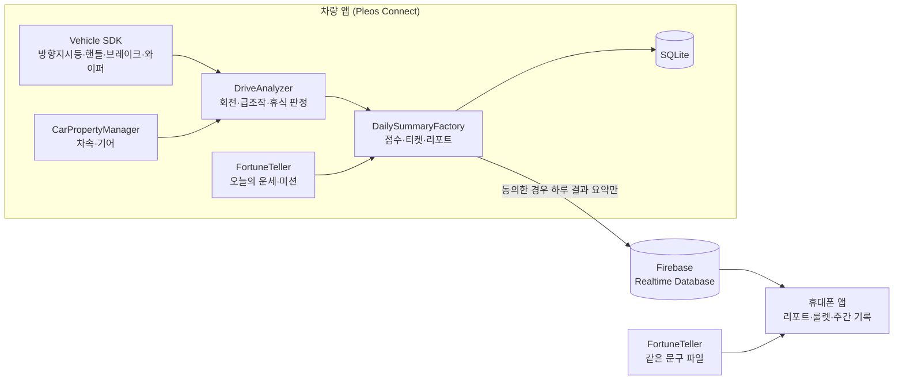

# 오늘의 '운'전

> 오늘의 운세로 하루 운전을 기분 좋게 시작하고, 운전주행습관을 차가 직접 확인해 종합점수를 책정하여 보상으로 돌려주는 안전운전 습관 앱

현대자동차그룹 차량용 앱 개발 공모전(Pleos Connect) 출품작입니다.

```
출발 전 운세 카드 확인 → 주행(화면 없이 차량 신호만 기록) → 주차(P단) 후 점수·리포트 → 받은 티켓으로 룰렛
```

| 오늘의 점수 | 운세 점수(대길 100 · 길 90 · 소길 80) × 주행 가중치(0.5~1.5) + 미션 달성 5점 |
|---|---|
| 룰렛 티켓 | 100점 이상 1장, 130점 이상 2장(하루 최대 2장), 7일 연속 100점 이상이면 1장 추가 |
| 주행 가중치 | 회전 시 방향지시등, 방향지시등 미리 켜기(3초), 10km당 급조작, 빗길 운전, 장거리 휴식 |

---

## APK 위치

| 파일 | 내용 |
|---|---|
| [`apk/마그마를누가마그나_오늘의운전_release.apk`](apk/) | 차량 앱(Pleos Connect). demo 빌드: 기획서 이용 사례를 시연 주행으로 바로 재생 |
| [`apk/마그마를누가마그나_오늘의운전_phone_release.apk`](apk/) | 휴대폰 앱(Android 8.0 이상) |

용량이 커져 저장소에 올리지 못하면 [Releases](../../releases)에 올리고 이 표에 링크를 남깁니다.

---

## 실행 방법

### 1. 준비

1. Android Studio(Ladybug 2024.2 이상)와 JDK 17을 설치합니다.
2. [Pleos Playground](https://pleos.ai/playground)에서 Pleos Connect Emulator를 설치합니다(API 28 이상).
3. 저장소를 받아 Android Studio에서 루트 폴더를 엽니다. Gradle 동기화 때 Pleos Maven 저장소(`nexus-playground.pleos.ai`)에서 Vehicle SDK 2.3.2를 받습니다.

### 2. 차량 앱 - 시연 주행(demo 빌드, 추가 설정 없음)

1. **Build Variants**에서 `car-app`을 `demoDebug`로 고릅니다.
2. Pleos Connect Emulator에서 `car-app`을 실행합니다.
3. 첫 화면 오른쪽 아래 **시연 주행**에서 시나리오를 고르고 **시연 주행 시작**을 누릅니다.
4. 약 40초 동안 주행 신호가 재생되는 동안 화면은 "운전에 집중하세요"만 보여 주고, P단에 들어가면 주차 리포트가 자동으로 뜹니다.
5. 리포트에서 **룰렛 돌리기**로 받은 티켓을 씁니다.

| 시나리오 | 주행 | 판정 결과 | 주행 가중치 |
|---|---|---|---|
| 출근길(사례 1) | 12.4km | 회전 5번 중 4번 깜빡이(미리 켠 건 1번), 급감속 1번 | 1.2 |
| 서두른 날(사례 2) | 10.5km | 회전 5번 중 2번 깜빡이, 급가속·급감속 1번씩 | 0.8 |
| 비 오는 퇴근길 | 11.0km | 와이퍼 ON, 급조작 없음, 깜빡이 모두 미리 | 1.5(상한) |
| 고향 가는 길(사례 3) | 160km | 1시간 40분 주행 후 20분 휴식, 급감속 9번 | 1.35 |

오늘의 점수는 그날 운세 등급에 따라 달라집니다(예: 길 90점 × 1.2 = 108점).

### 3. 차량 앱 - 실제 차량 신호(vehicle 빌드)

1. **Build Variants**에서 `car-app`을 `vehicleDebug`로 고릅니다.
2. 실행 후 차속 권한(`android.car.permission.CAR_SPEED`)을 허용합니다.
3. Virtual Console에서 기어·핸들 각도·방향지시등·브레이크·와이퍼를 바꾸고, 속도는 adb로 넣습니다.

```bash
adb shell cmd car_service inject-vhal-event 0x11400400 8      # 기어 D
adb shell cmd car_service inject-vhal-event 0x11600207 8.3    # 속도 8.3m/s(약 30km/h)
adb shell cmd car_service inject-vhal-event 0x11400400 4      # 기어 P → 주차 리포트
```

Vehicle SDK 리스너 연결 상태는 Logcat 태그 `PleosBridge`에서 확인합니다. 자세한 내용은 [docs/vehicle-signals.md](docs/vehicle-signals.md)에 있습니다.

### 4. 휴대폰 연동(선택)

차량 앱만으로 모든 기능이 동작합니다. 휴대폰에서 이어 보려면 연동 서버를 설정합니다.

1. Firebase 콘솔에서 Realtime Database를 만들고 [firebase/database.rules.json](firebase/database.rules.json)을 규칙으로 붙여 넣습니다.
2. 루트의 `local.properties`에 주소를 넣습니다(저장소에 올리지 않는 파일).
   ```properties
   firebase.dbUrl=https://<프로젝트>-default-rtdb.asia-southeast1.firebasedatabase.app
   ```
3. `car-app`과 `phone-app`을 다시 빌드해 설치합니다.
4. 차량 앱 **휴대폰 연결** → 동의 체크 → **연결 코드 만들기** → 휴대폰 앱 **차와 연결하기**에 6자리 코드를 입력합니다.

### 5. 단위 테스트

```bash
./gradlew :core:test
```

운세 선택, 회전·방향지시등·급조작 판정, 가중치·점수·티켓 계산, 연동 데이터 66개 테스트입니다. 기획서의 계산 예시(90 × 1.2 = 108점, 80 × 1.35 + 5 = 113점, 100 × 0.8 = 80점)를 차량 신호 시나리오로 재현해 확인합니다.

### 6. 제출용 APK 만들기

```bash
./gradlew :car-app:copySubmissionApk :phone-app:copySubmissionApk
```

release 빌드를 만들어 `apk/` 폴더에 `마그마를누가마그나_오늘의운전_release.apk` 형식으로 복사합니다. 팀 이름은 루트 `build.gradle`의 `teamName`에서 바꿉니다. 서명 키가 없으면 디버그 키로 서명되어 에뮬레이터에 바로 설치할 수 있습니다(`keystore.properties.example` 참고).

---

## 테스트 환경·필요 설정

| 항목 | 내용 |
|---|---|
| 개발 도구 | Android Studio Ladybug(2024.2) 이상, JDK 17, Gradle 8.10.2(래퍼 포함), AGP 8.8.2 |
| 차량 앱 | Pleos Connect Emulator, minSdk 28 / targetSdk 35, Java |
| 휴대폰 앱 | Android 8.0(API 26) 이상 에뮬레이터 또는 기기, Java |
| SDK | Pleos Vehicle SDK 2.3.2(vehicle 빌드), AAOS Car API(`useLibrary 'android.car'`), AndroidX WorkManager 2.9.1 |
| 연동 서버 | Firebase Realtime Database(무료 요금제), REST API로만 통신(google-services.json 불필요) |
| 필요 설정 | 휴대폰 연동을 쓸 때만 `local.properties`에 `firebase.dbUrl` |
| 차량 권한 | `android.car.permission.CAR_SPEED`(실행 중 요청), `CAR_POWERTRAIN`, Vehicle SDK 읽기 권한(vehicle 빌드) |

---

## 저장소 구조

```
├── core/        공통 Java 모듈(안드로이드 없음) - 차량·휴대폰 앱이 함께 씀
│   ├── fortune/   운세 등급·띠·미션, 문구 파일(resources/fortune/phrases.tsv)
│   ├── drive/     차량 신호 → 회전·방향지시등·급조작·빗길·휴식 판정(DriveAnalyzer), 시연 시나리오
│   ├── score/     주행 가중치, 미션 판정, 오늘의 점수
│   ├── report/    잘한 점·아쉬운 점, 주간 비교, 하루 결과 요약 만들기
│   ├── reward/    티켓 규칙, 티켓 장부, 룰렛 상품표
│   └── link/      하루 결과 요약, 연결 코드, Firebase REST 클라이언트
├── shared-ui/   룰렛 화면(RouletteView)
├── car-app/     차량 앱
│   ├── src/main/      화면(운세 카드·주차 리포트·룰렛·연결 코드), 주행 기록 서비스, SQLite
│   ├── src/demo/      시나리오 재생 신호
│   └── src/vehicle/   Vehicle SDK + CarPropertyManager 신호
├── phone-app/   휴대폰 앱(운세·리포트·룰렛·주간 기록, 알림)
├── firebase/    Realtime Database 보안 규칙
├── docs/        점수 규칙, 차량 신호 연결, 연동 구조, 시연 방법
└── apk/         제출용 APK
```



---

## 구현 현황

| 항목 | 상태 |
|---|---|
| 공통 모듈: 운세, 판정, 점수, 티켓, 룰렛, 연동 데이터 | 완료, 단위 테스트 66개 |
| 차량 앱 화면: 운세 카드, 주차 리포트, 룰렛, 휴대폰 연결 코드 | 완료 |
| 차량 앱 demo 빌드: 기획서 이용 사례 시연 주행 | 완료 |
| 차량 앱 vehicle 빌드: 차속·기어·주행 제한(CarPropertyManager, CarUxRestrictionsManager) | 완료 |
| 차량 앱 vehicle 빌드: Vehicle SDK 방향지시등·핸들·브레이크·와이퍼 | 에뮬레이터에서 리스너 시그니처 확인 중(11/16~11/23) |
| 휴대폰 앱: 연결, 운세·미션, 리포트, 룰렛, 주간 기록, 알림 | 완료(연동 서버 설정 필요) |
| 안전벨트 미션, NaviHelper 장거리 미션 | 선택 항목, 지원 여부 확인 후 |
| 운세·미션·꿀팁 문구 | 시드 54개 → 100개(11/23) → 출시 365개 |

---

## 개인정보와 운전 안전

- 주행 중에는 화면에 아무것도 띄우지 않습니다. 차량 화면은 주차 중에만 쓰고(distractionOptimized 미선언), 주행 중 기록은 포그라운드 서비스가 신호 콜백만 받아 처리합니다.
- 주행 기록과 생년월일은 차량 내부 저장소(SQLite)에만 둡니다. 생년월일은 띠별 운세에만 쓰며 서버로 보내지 않습니다.
- 휴대폰 연동은 사용자가 동의한 경우에만 켜지고, 하루 결과 요약(점수, 티켓 수, 잘한 점·아쉬운 점, 주행 거리·시간)만 보냅니다. 위치와 주행 원본 기록은 보내지 않습니다.
- 연결은 6자리 연결 코드로 하며 이름·전화번호를 묻지 않습니다. 코드는 10분 뒤 만료되고 한 번 쓰면 지웁니다.
- 룰렛 칸 크기는 실제 당첨 확률에 비례하게 그리고, 확률표를 화면에 함께 보여 줍니다.

## 문서

- [점수 규칙](docs/scoring-rules.md): 평가 항목, 판정 기준값과 근거, 설정 파일 키
- [차량 신호 연결](docs/vehicle-signals.md): 신호별 사용 API, Vehicle SDK 확인 체크리스트
- [연동 구조](docs/phone-link.md): 서버 데이터 구조, 보안 규칙, 티켓 중복 사용 방지
- [시연 방법](docs/demo-guide.md): PT 시연 순서, 시나리오 파일 만들기

## 역할

| 팀원 | 담당 |
|---|---|
| 팀원 A | 차량 신호 연결, 판정·점수 계산 코드, 서버 연동, 테스트 |
| 팀원 B | 차량·휴대폰 화면, 운세·미션·꿀팁 문구, 시연 시나리오와 발표 자료 |
