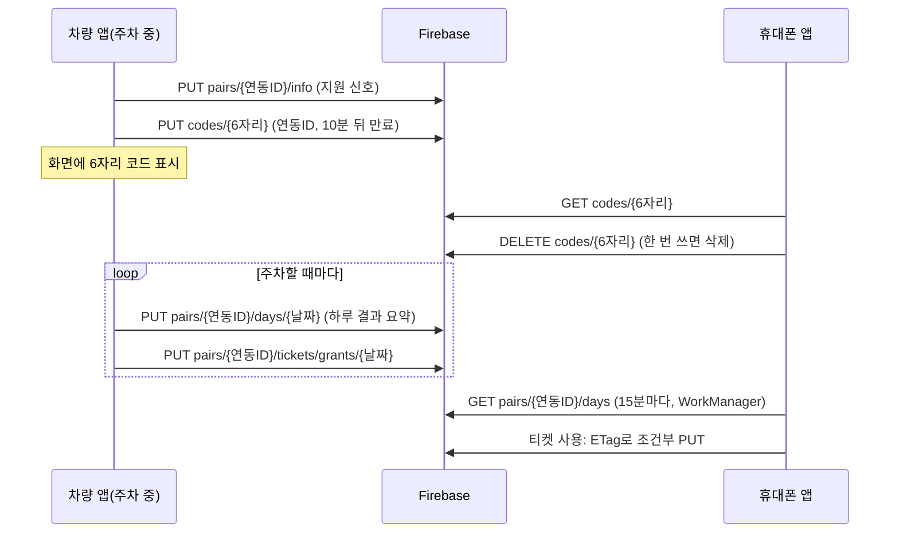

# 휴대폰 연동 구조

Pleos의 스마트폰 연동 SDK가 아직 공개 전이라, Firebase Realtime Database(무료 요금제)를 REST API로 써서 직접 구현했습니다. 공식 연동 SDK가 공개되면 `RemoteStore` 구현만 바꿔 옮깁니다.

## 1. 흐름



## 2. 데이터

```
codes/{6자리 코드}            { pairId, expiresAt }
pairs/{연동ID}/info           { createdAt, support: ["SPEED", "TURN_SIGNAL", ...] }
pairs/{연동ID}/days/{날짜}     DailySummary
pairs/{연동ID}/tickets        { grants: { 날짜: 장수 }, spins: { 기록ID: { at, prizeId, prizeName, win, device } } }
```

`DailySummary`에 들어가는 것: 날짜, 점수, 가중치, 운세 등급, 미션과 달성 여부, 받은 티켓 수, 잘한 점·아쉬운 점, 응원 한마디, 가중치 항목 문구, 주행 거리·시간, 주간 기록용 횟수(회전, 깜빡이, 미리 켜기, 급조작).

들어가지 않는 것: 위치, 주행 원본 신호, 생년월일, 이름·전화번호·이메일. (`LinkTest.요약에는_위치나_개인정보_항목이_없다`에서 확인)

운세는 휴대폰 앱이 같은 문구 파일(`core/src/main/resources/fortune/phrases.tsv`)과 같은 규칙으로 직접 만듭니다. 그래서 생년월일을 보내지 않아도 같은 운세가 나옵니다(같은 생년월일을 양쪽에 넣었을 때).

## 3. 티켓을 한 번만 쓰게 하는 방법

- 받은 티켓은 날짜를 키로 저장합니다. 같은 날 결과를 여러 번 올려도 덮어쓸 뿐 두 번 쌓이지 않습니다.
- 티켓을 쓸 때는 `X-Firebase-ETag`로 장부를 읽고, `if-match`로 그 사이 아무도 바꾸지 않았을 때만 씁니다. 다른 기기가 먼저 바꿨으면(412) 다시 읽어 재시도합니다(`LinkService.spendTicket`).
- 연결하기 전 차량에서 돌린 룰렛 기록은 연결할 때 서버 장부로 옮깁니다(`importSpins`).

## 4. 보안 규칙

[`firebase/database.rules.json`](../firebase/database.rules.json)

- 루트 전체 읽기·쓰기를 막아, 연동 ID를 모르면 아무것도 읽을 수 없습니다(목록 조회 불가).
- 연동 ID는 128bit 난수(32자리 16진수)라 추측할 수 없습니다.
- 연결 코드는 6자리 숫자만 허용하고, 10분 뒤 만료되며 한 번 쓰면 지웁니다.

시연 단계 구조입니다. 실제 상품을 주는 단계에서는 Firebase 익명 인증으로 기기를 구분하고, 룰렛 당첨 결정과 티켓 차감을 서버(Cloud Functions)에서 하도록 옮깁니다.

## 5. 무료 요금제 한도

| 항목 | Spark 요금제 | 이 앱 사용량 |
|---|---|---|
| 동시 연결 | 100 | REST 요청만 사용(상시 연결 없음) |
| 저장 | 1GB | 하루 요약 1건 약 1KB |
| 다운로드 | 하루 360MB | 휴대폰이 15분마다 기록 조회 |
